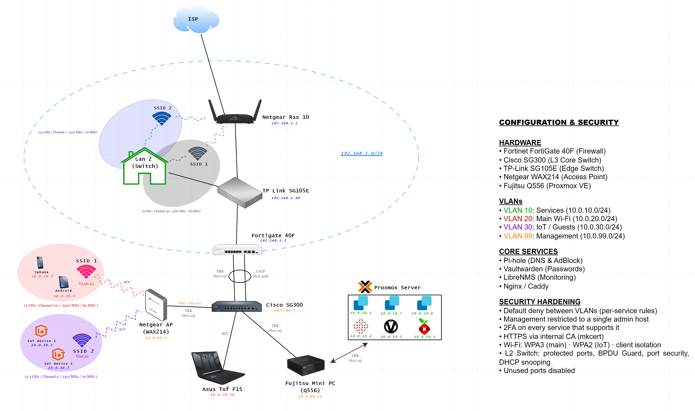
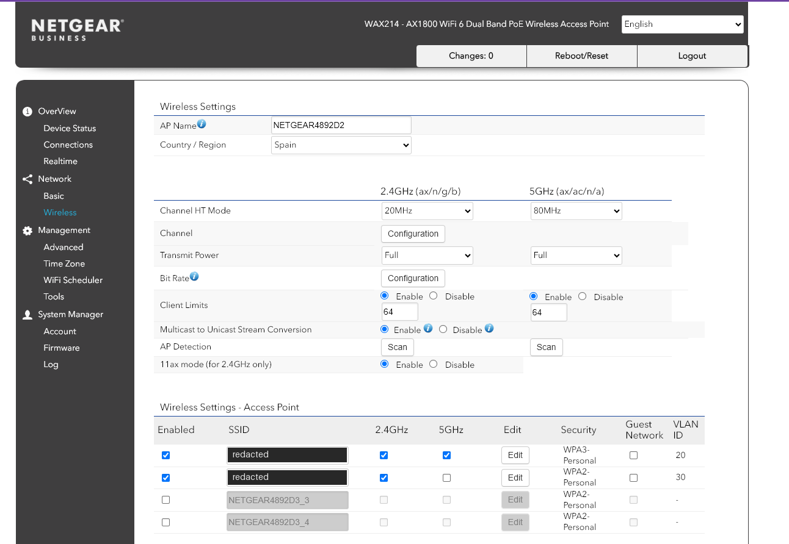
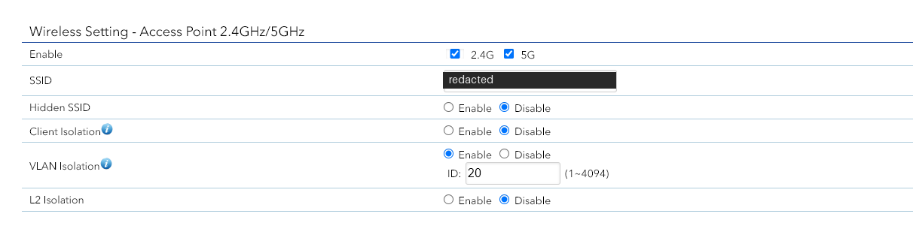
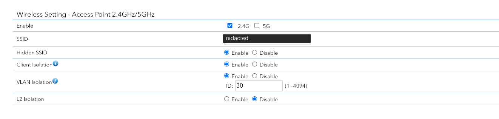
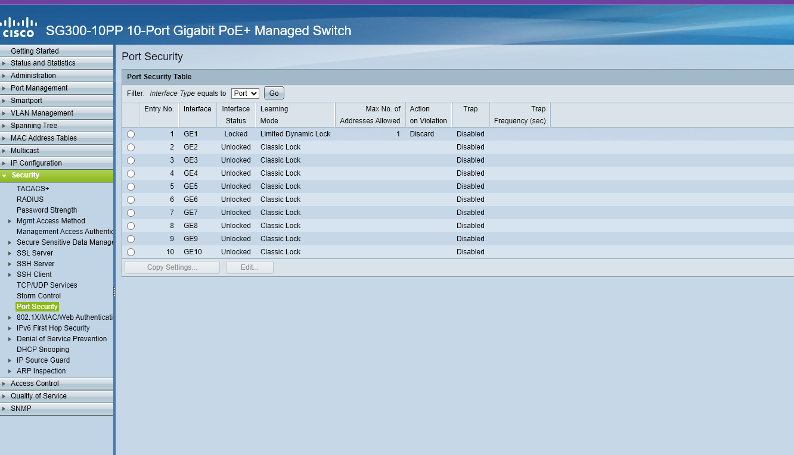
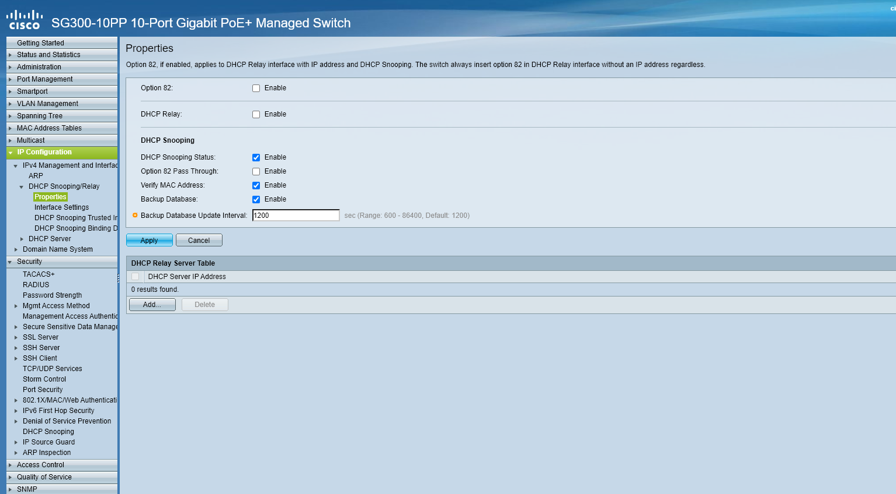
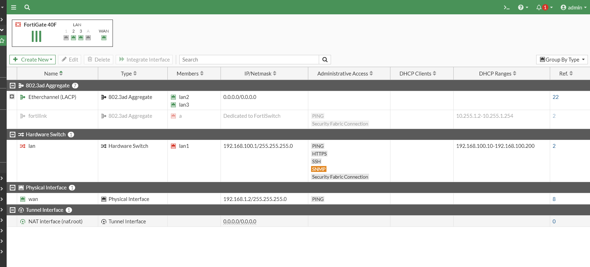
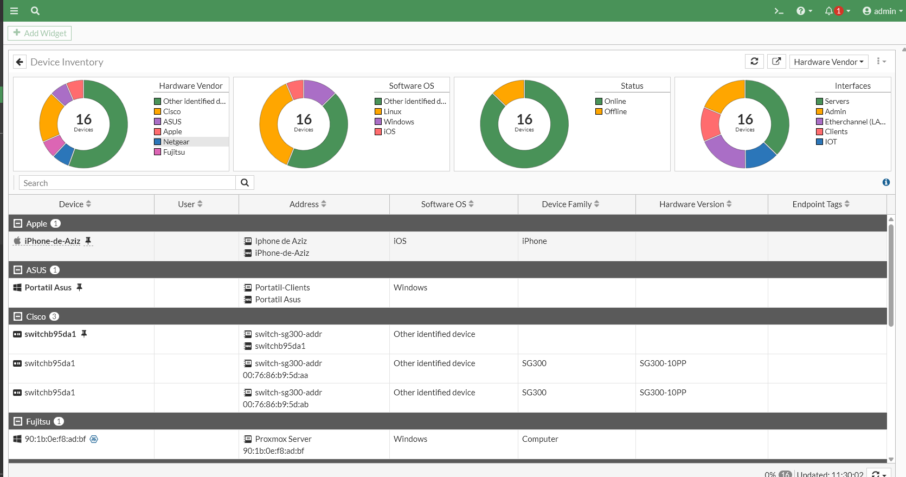

# Homelab · this week's edition

My home network as of 23 November 2026: a FortiGate 40F, a Cisco SG300, a Wi-Fi 6 access point and a mini PC running Proxmox, split into four VLANs. It's here in case it helps someone build theirs. Take whatever's useful; the mistakes come free of charge.

> [!WARNING]
> **If you're a black hat:** yes, below you'll find the topology, the addressing and the full firewall policy list. Before you get excited:
> - It changes almost every week. By the time you've mapped it, I'll have renumbered a VLAN, broken DNS and restored a backup.
> - It all sits behind my ISP's CGNAT, the house router's NAT and the FortiGate's NAT. Triple NAT. Some days I can't reach it either.
> - There isn't a single inbound policy on the FortiGate's WAN, and the SSL-VPN is off.
>
> If you want to break network gear, there are bug bounty programs that actually pay for it (i won´t).

## Topology



Two networks, one inside the other:

- **House network, `192.168.1.0/24`.** ISP → Netgear RAX10 → TP-Link SG105E, plus the house Wi-Fi and the rest of the family. Off limits: if Netflix drops at home, the homelab gets unplugged by popular vote.
- **Lab, `10.0.x.0/24`.** The FortiGate's WAN (`192.168.1.2`) is just another client of the house network. Everything behind it is mine to break.

```
FortiGate 40F  (lan2 + lan3)
      ║  LACP · 802.1Q trunk
Cisco SG300-10PP  (GE9 + GE10)
      ├── GE1  Asus TUF F15         access, VLAN 20
      ├── GE2  Fujitsu Q556 (PVE)   trunk
      └── GE3  Netgear WAX214       trunk, PoE+
```

| Device | Job | Management IP |
|---|---|---|
| Fortinet FortiGate 40F | Firewall and inter-VLAN routing | `.1` on every VLAN |
| Cisco SG300-10PP | Core switch (L3-capable, running in L2 mode) | `10.0.99.3` |
| Netgear WAX214 | Wi-Fi 6 AP, powered over PoE+ | `10.0.99.2` |
| Fujitsu Esprimo Q556 | Proxmox VE (i5-7500T, 24 GB RAM) | `10.0.99.10` |
| Asus TUF F15 | Daily driver and the only admin workstation | `10.0.20.10` |
| Netgear RAX10 + TP-Link SG105E | House router and switch, not part of the lab | `192.168.1.1` / `.69` |

## VLANs

| VLAN | Name | Subnet | Who lives there |
|---|---|---|---|
| 10 | Servers | `10.0.10.0/24` | Proxmox containers |
| 20 | Clients | `10.0.20.0/24` | Laptop and phones |
| 30 | IOT | `10.0.30.0/24` | Air purifiers, a Bitaxe and whatever guests bring |
| 99 | Admin | `10.0.99.0/24` | Switch, AP and Proxmox host management |
| 999 | Unused | — | No IP. Somewhere boring for unused ports to be |

## Services

All of them are containers on Proxmox, in VLAN 10.

| IP | Service | Notes |
|---|---|---|
| `10.0.10.2` | Vaultwarden | Behind Caddy |
| `10.0.10.4` | LibreNMS | SNMPv2c, alerts to Telegram, behind nginx |
| `10.0.10.5` | Pi-hole | The only resolver allowed to talk to the internet |
| `10.0.10.3`, `.6`, `.7` | Side projects | Bots, mostly. They get renamed more often than the VLANs |

Every web UI (FortiGate, SG300, LibreNMS, Vaultwarden) runs HTTPS with certificates from a private CA made with mkcert.

## Firewall

Full export: [`policy_standard_list_2026_11_23.json`](policy_standard_list_2026_11_23.json), 16 policies plus the implicit deny, in evaluation order.

Default deny between VLANs, and every exception gets its own policy:

| From ↓ · To → | Servers | Clients | IoT | Admin | Internet |
|---|---|---|---|---|---|
| **Servers** | — | ✗ | ✗ | LibreNMS only: SNMP, ping | Pi-hole: DNS. Rest: HTTP/S, NTP\* |
| **Clients** | DNS to Pi-hole. Laptop: everything | — | iPhone and laptop: everything | Laptop: everything | Everything |
| **IoT** | DNS to Pi-hole | ✗ | — | ✗ | HTTP/S, NTP\* |
| **Admin** | DNS to Pi-hole, SNMP traps to LibreNMS | ✗ | ✗ | — | HTTP/S, NTP\* |

\* Plus whatever `VLANS INTERNET` lets through while I'm testing.

The ones with a story:

- **`PORTATIL A TODO`** ("laptop to everything"). One laptop holds the keys to every VLAN. It's also a FortiGate trusted host, and its switch port accepts exactly one MAC address. If it gets stolen, so does the network. I've made my peace with that.
- **`Iphone a IoT`** lets the phone control the IoT devices. NAT is on, so they see the request coming from the FortiGate (`10.0.30.1`), inside their own subnet.
- **The DNS trio** (`PI-HOLE DNS OUT`, `VLANS DNS PI-HOLE`, `VLANS DNS FORCE`). Every VLAN resolves through the Pi-hole, and only the Pi-hole may send DNS out. Plain DNS and DoT to anywhere else get dropped: 85.91 MB of queries so far, from devices convinced they know better.
- **The isolation rules at the bottom** are redundant with the implicit deny, but they give each VLAN its own hit counter. That's how I know the IoT devices have never once tried to leave: 0 B.

By the numbers:

| Policy | Bytes | |
|---|---|---|
| Clients to Internet | 203.03 GB | 70% of all traffic through the firewall |
| NMS VIP | 585.18 MB | LibreNMS asking every device "you OK?" |
| Admin to Internet | 63.22 kB | The network gear barely goes online |
| Implicit Deny | 960 B | Whatever nobody planned for |

## Wi-Fi (Netgear WAX214)

| SSID | Bands | Security | VLAN | Notes |
|---|---|---|---|---|
| Main | 2.4 + 5 GHz | WPA3-Personal | 20 | |
| IoT | 2.4 GHz | WPA2-Personal | 30 | Hidden, client isolation on |

WPA2 on the IoT SSID is for compatibility: plenty of IoT devices hear "WPA3" and refuse to pair. Hiding the SSID stops nobody, but it keeps the neighbours' Wi-Fi list tidy.

Channels are picked so the lab AP and the house router don't step on each other:

| Band | RAX10 (house) | WAX214 (lab) |
|---|---|---|
| 2.4 GHz | Ch 1, 20 MHz | Ch 6, 20 MHz |
| 5 GHz | Ch 36, 80 MHz | Ch 100, 80 MHz |

Channel 100 is DFS, so if a weather radar shows up, the AP changes channel without asking.

SSID names are blacked out in the screenshots. Showing you my firewall rules is fine; showing you where I live on WiGLE, less so.

<details>
<summary>Screenshots</summary>





</details>

## Switching (Cisco SG300-10PP)

- LACP to the FortiGate over two links. Tested by pulling one cable: traffic kept flowing and LibreNMS complained on Telegram.
- DHCP snooping with MAC verification and a backed-up binding database.
- Port security on GE1 (the laptop): one MAC address, anything else is discarded.
- Protected ports on GE1–GE8, BPDU Guard on edge ports, GE4–GE8 shut down.

<details>
<summary>Screenshots</summary>




</details>

## Management and monitoring

- FortiGate admin access only from trusted hosts: the laptop, and LibreNMS because it needs SNMP.
- The WAN answers ping and nothing else.
- `lan1` stays out of the LAG on its own subnet (`192.168.100.1/24`) as a plan B for the day I lock myself out.
- 2FA on every service that supports it.
- LibreNMS polls the FortiGate, SG300, WAX214 and Proxmox, and sends alerts to Telegram.

Meanwhile, the FortiGate's device inventory is convinced my Proxmox host is a Windows machine. I haven't had the heart to tell it.

<details>
<summary>Screenshots</summary>




</details>

## Work in progress

Some things in here aren't how they should be, and I know. This is a test bench: rules get added, broken and cleaned up as I try ideas out, so the config you see is always halfway through some experiment. If something looks wrong, it's probably mid-test. If it still looks wrong next month, open an issue.

## What's next

Plans as of today. Ask again next week.

- An IPsec tunnel from the FortiGate to a VPS, so the Clients VLAN goes out through it.
- A dedicated IDS sensor on a mirror port of the SG300.

Version 1 of this homelab had no VLANs and a Suricata + ELK box on a mirror port: [ZizoNets/suricata-elk-home-ids](https://github.com/ZizoNets/suricata-elk-home-ids).
